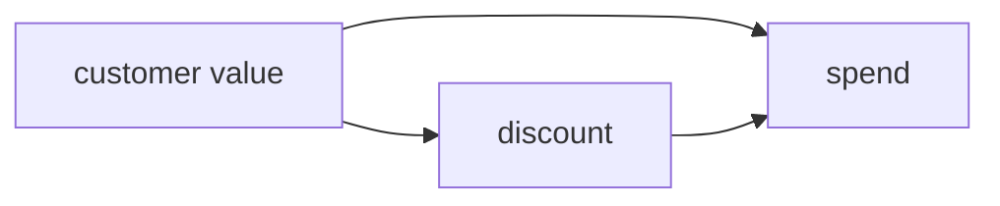

# Get started

You have data and a decision to make. The fastest answer, comparing the averages, can be
confidently and expensively wrong, and no dashboard will warn you. Here is causal inference
earning its keep in five minutes. No background needed; if the ideas themselves are new, the
[learn series](learn/index.md) takes them from zero.

```bash
pip install ergodic   # or: uv add ergodic
```

The data below is simulated, so the true answer is known: we plant the discount's real effect
at exactly **$6** per customer. Watch the obvious method miss it and ergodic find it. The full
runnable script is at the [bottom of the page](#reproduce-every-number).

## "The discount worked!"

You emailed a $50 discount to part of your customer base. The customers who got it went on to
spend more than the ones who did not. Roll it out to everyone?

```python
# `frame`: one row per customer, with `value` (a standing tendency to spend),
# `discount` (1 if they were emailed the offer), and `spend` (what they spent after).
discounted = frame.loc[frame.discount == 1, "spend"].mean()
rest = frame.loc[frame.discount == 0, "spend"].mean()
discounted - rest      # +$22.69 per customer
```

A large, profitable-looking lift. It is also wrong, and the error is not noise: collect ten
times the data and it stays.

## Who got the discount?

The offer did not go out at random. Your team sent it to high-value customers, the ones who
were going to spend more anyway. Customer value drives *both* who got the discount *and* how
much each person spends. Drawn as a causal graph:



`value` is a ==confounder==: a common cause sitting behind both the treatment and the outcome.
The naive comparison hands the discount credit for spending that the customers' own value
produced. To isolate what the discount did, you have to hold value fixed.

## The causal answer

Give ergodic the graph and the data. It reads the graph, sees that adjusting for `value`
identifies the effect, picks an estimator, fits it, and returns a number with an interval.

```python
from ergodic import dag, tabular, estimate_effect

g = dag(["value -> discount", "value -> spend", "discount -> spend"])
estimate_effect(g, tabular(frame), "discount", "spend")
# EffectEstimate(aipw, analytic: ate=5.91, se=0.395, 95% CI [5.14, 6.68], n=4000)
```

The real effect of the discount is about **$6 per customer**, the $6 we planted, not $23.
ergodic recovered it as $5.91 with a tight interval. The missing $17 was customer value
showing up as a treatment effect. If the discount costs more than $6 a head, the naive number
would have sent you into a money-losing rollout sure it was a winner.

## What just happened

You gave ergodic a *model* of the problem, not just the numbers, and it did three things plain
regression does not do on its own:

1. **Identification.** It checked the graph and confirmed the effect *can* be recovered from
   this data, by adjusting for `value`. Change the graph and the answer can flip to "you
   cannot, not from this data", which is an honest result and a useful one.
2. **Estimation.** It chose a suitable estimator (a doubly robust one), fit it, and reported
   its uncertainty.
3. **A claim you can argue with.** The graph is a stated assumption. A colleague can point at
   an edge and disagree, which is the point: the assumptions are on the table, not buried in a
   model's fine print.

Don't know the graph? ergodic can [learn it from the data](discovery.md), then estimate
straight off what it finds.

## Reproduce every number

??? note "The simulated world, and the planted answer (runnable top to bottom)"

    ```python
    import numpy as np
    import pandas as pd
    from ergodic import dag, tabular, estimate_effect

    rng = np.random.default_rng(7)
    n = 4000

    # customer value: a standing tendency to spend (the confounder)
    value = rng.normal(50, 15, n)

    # targeting: higher-value customers are likelier to get the discount
    p = 1 / (1 + np.exp(-(-4 + 0.08 * value)))
    discount = rng.binomial(1, p)

    # spend: the discount truly adds $6; value drives much more
    true_effect = 6.0
    spend = 20 + true_effect * discount + 1.2 * value + rng.normal(0, 10, n)

    frame = pd.DataFrame({"value": value, "discount": discount, "spend": spend})

    # the obvious answer, inflated by who got targeted
    naive = frame.loc[frame.discount == 1, "spend"].mean() - frame.loc[frame.discount == 0, "spend"].mean()
    print(round(naive, 2))                       # 22.69

    # the causal answer, adjusting for value
    g = dag(["value -> discount", "value -> spend", "discount -> spend"])
    print(estimate_effect(g, tabular(frame), "discount", "spend"))
    # EffectEstimate(aipw, analytic: ate=5.91, se=0.395, 95% CI [5.14, 6.68], n=4000)
    ```

## Where to go next

<div class="grid cards" markdown>

-   :material-school-outline:{ .lg .middle } __New to the ideas?__

    ---

    The [learn series](learn/index.md): ten guides from zero, each on a story like this one,
    no background assumed.

-   :material-cube-outline:{ .lg .middle } __The objects underneath__

    ---

    [Foundations](foundations.md): the graph, domain knowledge, the typed data, and how a graph
    becomes an estimand.

-   :material-layers-outline:{ .lg .middle } __Pick a method__

    ---

    [Pillars](pillars.md): causal discovery, causal inference, and process intelligence, end to
    end.

-   :material-book-open-variant:{ .lg .middle } __The full surface__

    ---

    The [API reference](reference.md) for every object and function.

</div>
